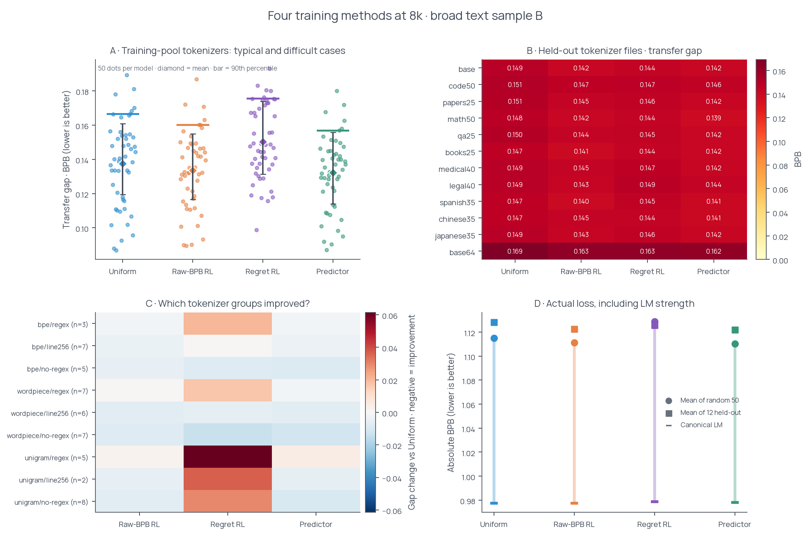

# Four training methods at step 8,000

Every checkpoint is frozen. All four models score the same 50 randomly sampled training-pool tokenizer files and 12 held-out tokenizer files on the same 576 broad-text passages. No passages were selected for having high model loss.

**Scoring:** BOS + unscored prefix + 32 scored canonical continuation tokens, within 128 total positions. Only prefix embeddings are transferred. The canonical continuation embeddings and output head remain fixed. Every tokenizer uses the same prefix text and target bytes.

**Gap = transferred BPB − that checkpoint’s canonical BPB. Lower is better.** Absolute BPB is reported separately because a smaller transfer gap can accompany a weaker LM. Scores are byte-weighted within each domain, then averaged equally over nine domains.

## What the early results say

On text sample B, the predictor has a mean training-pool gap of **+0.1321 BPB**, compared with +0.1376 for Uniform, +0.1336 for Raw-BPB RL and +0.1502 for Regret RL.

Compared with Uniform, the predictor changes mean pool gap by -0.0054 BPB (95% interval -0.0090 to -0.0016). The paired interval favors the predictor.

Compared with Raw-BPB RL, the predictor changes mean pool gap by -0.0014 BPB (95% interval -0.0062 to +0.0034). The paired interval does not resolve a difference.

Compared with Regret RL, the predictor changes mean pool gap by -0.0180 BPB (95% interval -0.0268 to -0.0102). The paired interval favors the predictor.

These are early results from one trained seed, on the fixed evaluation described below. They measure the resulting models; they do not establish that the predictor is the sole cause of the difference.

## Results

### Text sample A · 288 passages

| Model | Canonical BPB | Random 50 mean BPB | Random 50 mean gap | 90th-percentile gap | Held-out mean gap |
| --- | ---: | ---: | ---: | ---: | ---: |
| Uniform | 0.9777 | 1.0932 | +0.1155 | +0.1462 | +0.1299 |
| Raw-BPB RL | 0.9778 | 1.0858 | +0.1080 | +0.1348 | +0.1224 |
| Regret RL | 0.9788 | 1.1051 | +0.1263 | +0.1576 | +0.1244 |
| Predictor | 0.9789 | 1.0870 | +0.1081 | +0.1319 | +0.1238 |

### Text sample B · 288 passages

| Model | Canonical BPB | Random 50 mean BPB | Random 50 mean gap | 90th-percentile gap | Held-out mean gap |
| --- | ---: | ---: | ---: | ---: | ---: |
| Uniform | 0.9774 | 1.1150 | +0.1376 | +0.1667 | +0.1506 |
| Raw-BPB RL | 0.9775 | 1.1111 | +0.1336 | +0.1602 | +0.1449 |
| Regret RL | 0.9786 | 1.1288 | +0.1502 | +0.1756 | +0.1469 |
| Predictor | 0.9780 | 1.1101 | +0.1321 | +0.1569 | +0.1438 |

[Text sample A](four_way_8k_sample_a.png) · [Every tokenizer](four_way_8k_tokenizers.png) · [Text domains](four_way_8k_domains.png)

## What this comparison can establish

Look for lower absolute transferred BPB, a lower average transfer gap, and improvements in the difficult tokenizer tail. Inspect domain and tokenizer groups to see whether improvements are broad or whether weaknesses moved elsewhere. The random 50 estimate typical performance in the original 1,000-tokenizer pool; they cannot establish its absolute worst tokenizer. The 12 held-out cases are a fixed BPE panel, not a random sample of all unseen tokenizer algorithms.

**This is not a selector-only ablation.** Uniform and Raw-BPB were trained using the older cuts. Raw-BPB used entropy weight 0.01, while Regret RL used 0. Both newer methods use corrected paired training boundaries. All four use the corrected shared evaluation boundaries here. There is one training seed per method.

The nine domains are English web, code, math, medical, legal, Chinese, Japanese, Arabic and Hindi. Text samples A and B are the original screen and confirmation documents; neither is a loss-selected stress subset. Domain-specific results are retained so that the aggregate does not hide where changes occur.

95% intervals use paired source-document-cluster bootstrap resampling within domains. Intervals for the random-50 population mean additionally resample tokenizer IDs with finite-population correction. They do not cover retraining uncertainty or guarantee a population-wide tail estimate. See analysis.json for intervals, all group sizes, domain scores and paired changes.

## Reproduce

`python scripts/report_four_way_8k.py` reproduces the audit, analysis and figures from `modal_results/four_way_8k/results.json.gz`. The same loss data are included here as results.json.gz. The frozen plan pins checkpoints, native files, complete vocabulary features, runtime and evaluator source hashes. Large model weights, tokenizer files and text remain in cloud storage. Training was not resumed.
