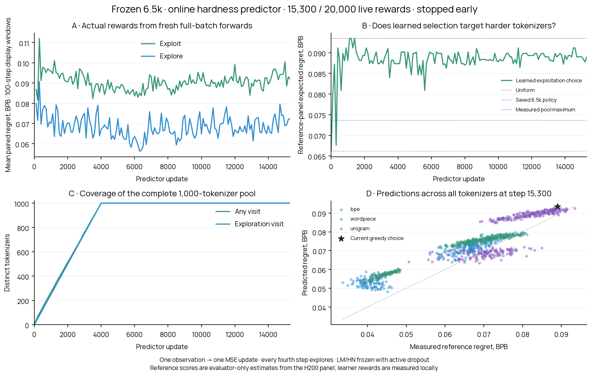

# Online hardness predictor on the frozen 6.5k model

**Stopped at the user’s request after 15,300 / 20,000 observations.** The pilot ended early at a saved checkpoint; this is not a completed 20k experiment. The LM and hypernetwork stay frozen. Only the small CPU settings predictor learns.

The shared 18→64→64→1 Tanh network predicts paired BPB gap. After each real reward evaluation, Adam at 0.001 makes one squared-error update on that observation. Every fourth step visits the next tokenizer in a shuffled complete-pool cycle; other steps choose the largest prediction, breaking ties uniformly. There is no initial warmup, replay buffer, entropy term or age weighting. A full 20k run gives each tokenizer exactly five exploration visits.

Each reward uses a fresh 128-example recipe-sampled training batch, the unchanged paired cut helper, variable canonical continuations, BOS + prefix + continuation ≤128 positions, and microbatch32. Canonical and transferred targets/bytes match exactly. Hypernetwork dropout stays active, with a fresh full native embedding table per observation. The validated memory implementation preserves full vocabularies.

The original 23-bucket corpus and complete tokenizer pool are checksum verified. Data sampling uses private Python seed42 and selector initialization/permutations use private seed43. Exact raw windows reserved for the reference panel and replacement banks are excluded from learner batches by content hashes while retaining recipe bucket choices.

The existing all-1,000 step-6,500 ranking is used only after learner updates for monitoring and assessment. Its labels never enter predictor training or action selection. It is a finite H200 estimate of the reward distribution; local Blackwell measurements are not asserted bitwise equal across devices. The same-device scorer and exact-resume checks are recorded in preflight.json.

Current greedy choices: **[83]**, reference ranks **[18]**. Expected reference gap: **+0.089013 BPB**; saved policy **+0.073636**; uniform **+0.066152**; measured maximum **+0.093447**.

Panel A plots actual observed rewards separately for exploration/exploitation, with display-only 100-step averaging. Panel B assesses the learned exploitation choice on the reference; mandatory exploration is excluded from that choice. C checks coverage. D checks the predictions across every pool tokenizer.

[PDF](hardness_predictor_6500.pdf) · [Learning curve](learning-curve.csv) · [All current predictions](current-predictions.csv)
