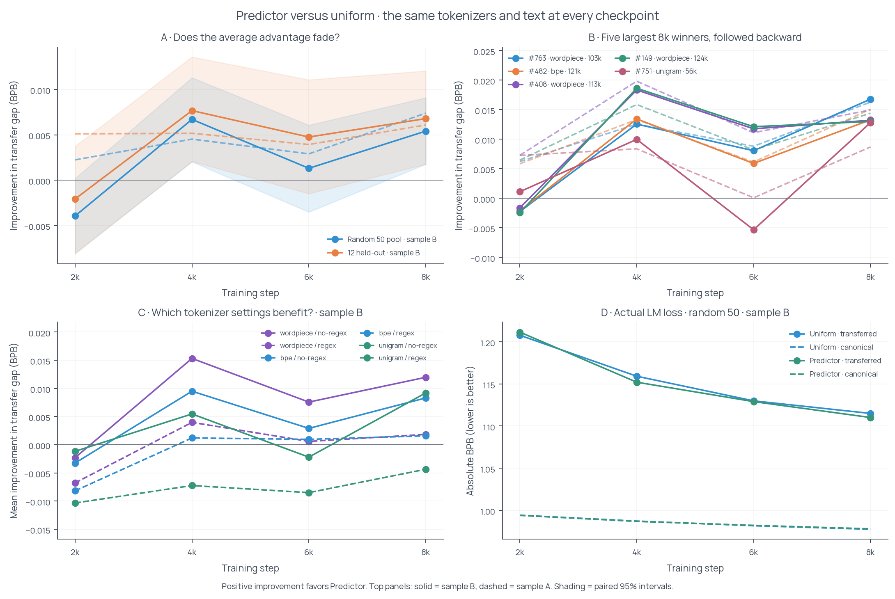

# Does the predictor help more early in training?

Both actual training runs are evaluated at 2k, 4k, 6k and 8k on exactly the same 62 tokenizers and 576 broad-text passages. There are 50 randomly drawn training-pool tokenizers and 12 held-out tokenizers. No tokenizer or passage is dropped. The original 8k results are reused unchanged.

**Improvement = Uniform transfer gap − Predictor transfer gap. Positive favors Predictor.** Each transfer gap subtracts that checkpoint’s own canonical score. Absolute BPB and canonical BPB are saved separately, so changes in the LM are visible.

Scoring preserves the four-way evaluation: BOS + unscored prefix + 32 scored canonical continuation tokens, within 128 positions. Only prefix embeddings are transferred. Every pair scores 18,432 tokens and 53,707 bytes. Scores are byte-weighted within each of nine domains, then averaged equally over domains.

## What we found

Some tokenizers have larger improvements at 4k than at 8k, but there is no consistent pattern of a steadily fading advantage. Sample B has its largest average pool improvement at 4k; sample A has its largest at 8k. Both show a dip at 6k. The paired interval for the difference between the 4k and 8k pool advantages on sample B includes zero, so that small average difference is unresolved.

For concrete examples, WordPiece/no-regex tokenizers #912, #149 and #408 have larger point-estimate advantages at 4k than 8k on both text samples. These are descriptive examples from the complete table, not new independent hypothesis tests. The tokenizer-specific trajectories differ: #763, the largest 8k winner on sample B, has a larger advantage at 8k than at 4k on both samples.

## Average improvement

| Step | Pool · sample A | Pool · sample B | Held-out · sample A | Held-out · sample B |
| --- | ---: | ---: | ---: | ---: |
| 2,000 | +0.00224 | -0.00394 | +0.00511 | -0.00207 |
| 4,000 | +0.00452 | +0.00670 | +0.00516 | +0.00766 |
| 6,000 | +0.00290 | +0.00131 | +0.00393 | +0.00475 |
| 8,000 | +0.00739 | +0.00540 | +0.00608 | +0.00678 |

## Earlier advantage versus 8k

These paired intervals compare each earlier advantage with the 8k advantage, using the same resampled documents and tokenizer IDs at both steps. Positive means the advantage was larger earlier. They cover evaluation sampling uncertainty, not retraining uncertainty.

| Step | Pool difference · sample B | 95% interval |
| --- | ---: | --- |
| 2,000 versus 8k | -0.00935 | [-0.01462, -0.00403] |
| 4,000 versus 8k | +0.00129 | [-0.00419, +0.00684] |
| 6,000 versus 8k | -0.00410 | [-0.00902, +0.00101] |

[Every tokenizer at every checkpoint](predictor_trajectory_tokenizers.png) · [Full scores](tokenizer-scores.csv)

## Interpretation limits

The five highlighted tokenizers are selected retrospectively for their largest improvements at 8k on sample B. Their earlier trajectories are descriptive; sample B is not an independent confirmation after selecting those winners. All 62 scores and both text samples are retained.

This compares the resulting models from one training seed per method. Uniform used the older training boundaries, while Predictor used corrected paired boundaries. It therefore does not isolate the selector as the sole cause. The fixed 12 held-out BPE tokenizers do not represent all unseen tokenizer algorithms.

## Reproduction and persistence

`python scripts/report_predictor_trajectory.py` audits the complete saved loss bundle and reproduces the analysis, CSV and figures. The plan pins checkpoint hashes, parent panel and evaluator sources. Model weights, corpora and tokenizer files stay in cloud storage; local outputs contain only losses and provenance. No training was resumed.
