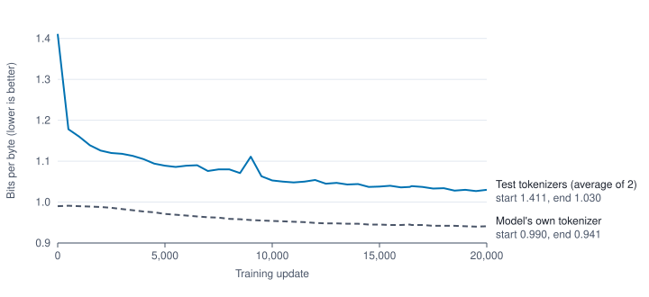
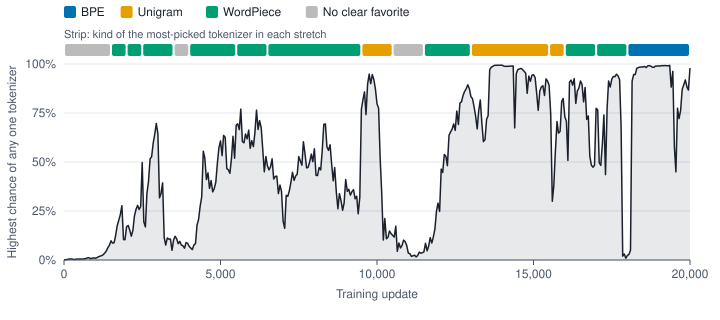
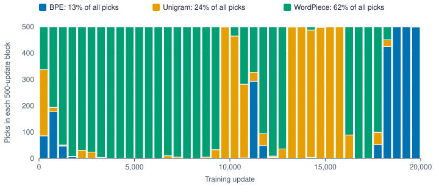

# Raw-BPB RL run on Tillicum: 20,000 updates

**The run finished all 20,000 updates.** On the trainer's built-in check, the average score on the two test
tokenizers fell from 1.411 to 1.030 bits per byte (27% lower). The gap to the model's own tokenizer shrank from
0.421 to 0.089 bits per byte (79% smaller). Three quarters of the drop in the test score happened in the first
2,000 updates.

This is not yet a comparison with the uniform baseline: see [Comparing with other runs](#comparing-with-other-runs).

## What was run

- One joint training run of SmolLM2-1.7B with an input-embedding hypernetwork, for 20,000 updates. It used
  Qingyun's raw-BPB trainer and launcher (`runtime/anytok_pool_raw_bpb_rl_20k`, `scripts/run_raw_bpb_training.py`,
  commit 670993b) and his exact input bundle ([docs/raw-bpb-handoff](../../docs/raw-bpb-handoff)).
- At every update, a tokenizer chooser picks one of the 1,000 training tokenizers. Its reward is the model's bits
  per byte on that update's 128 training passages, read through the chosen tokenizer and measured before the
  update changes the weights. So it is pushed toward tokenizers the model currently finds hard. Its entropy
  weight is 0: nothing pushes it to keep trying other tokenizers.
- Like the uniform baseline, these 20,000 updates are the start of a learning-rate schedule laid out for 190,000
  updates. The rate ramps up over the first 10,000 and is still about 99% of its peak at update 20,000.
- It ran on UW Hyak Tillicum, one H200 GPU at a time, from 2026-11-15 to 2026-11-17 (UTC). The cluster wrappers
  and the run guide are in [hyak/](../../hyak) ([hyak/README.md](../../hyak/README.md), section 0).

Words used here:

- **Bits per byte (BPB):** how many bits the model needs, on average, to predict each byte of text. Lower is
  better.
- **Hypernetwork:** a second network that builds the model's input vectors for any tokenizer's vocabulary, so the
  model can read text through tokenizers it wasn't built with.
- **The chooser:** a small policy that learns by trial and error (reinforcement learning, RL, with the REINFORCE
  method). "Raw BPB" names its reward, the plain bits per byte with the chosen tokenizer. Qingyun's twin "regret"
  run rewards instead the extra bits per byte over the model's own tokenizer.

## The check score during training



- Every 500 updates, the trainer runs a fixed check on 92 short passages (4 from each of 23 kinds of text), each
  cut once near its middle. The model reads the first part through one of two test tokenizers that it never
  trains on (32,768 pieces each), and is scored on how well it predicts the rest, which is always written in its
  own tokens. Each test tokenizer gets its own cuts, so the scored bytes differ slightly: 10,421 and 10,575.
- The dashed line is the same prediction of the same bytes after reading the first part with the model's own
  tokenizer. The distance between the two lines is the extra cost of reading through a tokenizer the model
  wasn't built with.
- Small ups and downs, such as the bump at update 9,000 (1.071, then 1.111, then 1.063), are real changes on
  these same passages, not measurement noise. But they rest on only about 10,500 bytes of text.

## What the chooser did



The line is the chooser's highest chance for any one tokenizer, read every 50 updates. With entropy weight 0, at
times it put almost all its weight on one tokenizer: up to 99.4% (update 13,950), and above 95% for most of
updates 13,600–14,750 and 18,300–19,450. It ended at 97.9%.

It did not stay on one tokenizer, though. The table lists the most-picked tokenizer of each stretch, and none
held that place for longer than 3,000 updates (#103, updates 6,501–9,500).

| Updates | Most picked | Kind | Share of picks | Rank on Qingyun's model |
| --- | --- | --- | ---: | ---: |
| 1–1,500 | No clear favorite | | | |
| 1,501–2,000 | #771 | WordPiece, no pre-splitting, 127k pieces | 17% | 323 |
| 2,001–2,500 | #103 | WordPiece, no pre-splitting, 127k pieces | 16% | 247 |
| 2,501–3,500 | #771 | WordPiece, no pre-splitting, 127k pieces | 31% | 323 |
| 3,501–4,000 | No clear favorite | | | |
| 4,001–5,500 | #103 | WordPiece, no pre-splitting, 127k pieces | 37% | 247 |
| 5,501–6,500 | #771 | WordPiece, no pre-splitting, 127k pieces | 62% | 323 |
| 6,501–9,500 | #103 | WordPiece, no pre-splitting, 127k pieces | 39% | 247 |
| 9,501–10,500 | #170 | Unigram, no pre-splitting, 125k pieces | 61% | 4 |
| 10,501–11,500 | No clear favorite | | | |
| 11,501–13,000 | #314 | WordPiece, split at lines, 125k pieces | 50% | 158 |
| 13,001–15,500 | #170 | Unigram, no pre-splitting, 125k pieces | 88% | 4 |
| 15,501–16,000 | #792 | Unigram, no pre-splitting, 113k pieces | 51% | 50 |
| 16,001–17,000 | #771 | WordPiece, no pre-splitting, 127k pieces | 71% | 323 |
| 17,001–18,000 | #873 | WordPiece, no pre-splitting, 125k pieces | 61% | 243 |
| 18,001–20,000 | #824 | BPE, no pre-splitting, 127k pieces | 87% | 582 |

- A 500-update block counts only if its most-picked tokenizer got at least 10% of the block's picks; otherwise it
  has no clear favorite. Neighbouring blocks with the same most-picked tokenizer are joined.
- The rank (1 = hardest of the 1,000) is borrowed from Qingyun's measurement of his twin regret run's model at
  update 6,500
  ([tokenizer-ranking.csv](https://github.com/qingy1337/anytok/blob/dc54fa64d81bafb071b213101049e416309bcdd2/reports/regret-pool-ranking-6500/tokenizer-ranking.csv),
  upstream branch `zett-modal-20k`). It ranks tokenizers by regret. Ranking the same measurements by raw bits per
  byte, this run's reward, moves the favorites somewhat: #771, for example, goes from 323 to 389.
- So the rank describes a different model, and is only a rough guide. Nobody has measured this run's own model
  against all 1,000 tokenizers, so it is unknown whether this run's favorites were the hardest ones for it.



Over the whole run, 62% of picks went to WordPiece tokenizers, 24% to Unigram and 13% to BPE (rounded), although
each kind is about a third of the pool (328 WordPiece, 340 Unigram, 332 BPE). Every tokenizer in the table had a
vocabulary of 113k–127k pieces, and all but #314 used no pre-splitting.

## How it ran, and what it cost

| Job | What it did | GPU-hours |
| --- | --- | ---: |
| Smoke test (473379) | A 3-update test before the real run | 0.05 |
| First try, job 1 (473452) | Updates 1–5,000; crashed while saving update 5,000 | 9.33 |
| First try, jobs 2 and 3 (473453, 473454) | Stopped at once because job 1 had failed | 0.00 |
| Restart, job 1 (481232) | Updates 4,001–16,409, resumed from the update-4,000 save | 23.67 |
| Restart, job 2 (481233) | Updates 16,410–20,000 | 6.83 |
| Restart, job 3 (481234) | Spare job, cancelled before it started | 0 |
| **Total** | | **39.9** |

- The cost was $35.89 in all, from the cluster's cost report, at $0.90 per H200 GPU-hour. The 100 free GPU-hours
  mentioned in the cluster docs were not applied. Redoing updates 4,001–5,000 took about 1.9 GPU-hours (roughly
  $1.70) at the restart's average speed.
- The first try crashed because the cluster's shared scratch storage was over its quota, so the update-5,000 save
  couldn't be written. The run resumed from the update-4,000 save, copied to project storage.
- GPU arithmetic isn't bit-for-bit repeatable. The redone updates matched the first try exactly up to update
  4,031, then drifted slightly, and from update 4,091 the chooser picked different tokenizers. The run's event log
  (`events.jsonl`, in the Hugging Face folder) keeps both versions; the last row for each update is the one this
  run kept.
- Restart job 1 was told to stop shortly before its 24-hour limit. It finished its current update and saved a
  full restart at update 16,409, and restart job 2 resumed from it.

## Comparing with other runs

The planned baseline is the original uniform run, which drew a tokenizer at random for every update. Its built-in
check used the same two test tokenizers and the same kinds of text, but it cut the passages in different places.

- Both trainers cut each check passage once and use that one cut for the test tokenizer and for the model's own
  tokenizer.
- The uniform trainer cuts at the exact middle character, even when that splits a word or one of the model's own
  tokens (`make_split_prefix_example` in `runtime/anytok_pool_20k/hf_hypernet/joint_training.py`).
- This trainer moves the cut to the nearest point between two of the model's own tokens
  (`make_paired_prefix_example` in `runtime/anytok_pool_regret_rl_20k/hf_hypernet/paired_reward.py`, which it
  imports).

So the two runs score different bytes, and their built-in check scores can't be compared directly. Only a final
evaluation that scores both final models the same way can say which run is better. None has been set up for this
run yet: the port's evaluation ([hyak/README.md](../../hyak/README.md), sections 6.13 to 6.15) is not wired to it
(section 0.7).

## Checkpoints

All 42 saves, the run's records and its settings are on Hugging Face:
[Dekiofsa/RLtokenizers, folder raw-bpb-rl-20k](https://huggingface.co/Dekiofsa/RLtokenizers/tree/main/raw-bpb-rl-20k).

- There is a save every 500 updates, plus update 16,409. Each holds the language model (`lm.pt`), the
  hypernetwork (`hypernet/`), the chooser (`policy.pt`) and a `manifest.json` with every file's size and SHA-256.
- The saves at updates 0, 2,000, 4,000 … 20,000 and 16,409 are full restarts: they also hold the trainer state
  and the optimizer, so training can continue from them.
- In the uploaded `run_config.json`, the cluster username in two file paths is replaced with `<user>`.

## Files in this folder

| Path | Contents |
| --- | --- |
| `data/results.json` | The tables behind this report: check scores every 500 updates, the chooser's focus every 50, picks in each 500-update block, the 1,000 training tokenizers, Qingyun's ranks and the jobs. It is the output of `code/add_difficulty.py`, with the cluster account's budget table removed. |
| `data/summary.json` | The headline numbers, the table of most-picked tokenizers, the kind shares and the total GPU-hours, recomputed by `code/make_report.py`. Other figures here are read straight from `data/results.json`. The dollar figures come from the cluster's cost report, which isn't included. |
| `plots/` | The three charts (SVG), drawn by `code/make_report.py`. |
| `code/extract_results.py` | Reads the finished run on the cluster without changing it, and prints the tables (`tables.json`). |
| `code/add_difficulty.py` | Adds Qingyun's ranks to `tables.json` and writes `results.json` next to itself. |
| `code/make_report.py` | Redraws the charts and `summary.json` from `data/results.json` (Python 3.9 or newer, no extra packages). |
| `code/write_manifest.py` | Writes `manifest.json`. |
| `manifest.json` | Size and SHA-256 of every other file in this folder. |

To redraw the charts and refresh the manifest:

```bash
python3 reports/raw-bpb-rl-20k-tillicum/code/make_report.py
python3 reports/raw-bpb-rl-20k-tillicum/code/write_manifest.py
```
