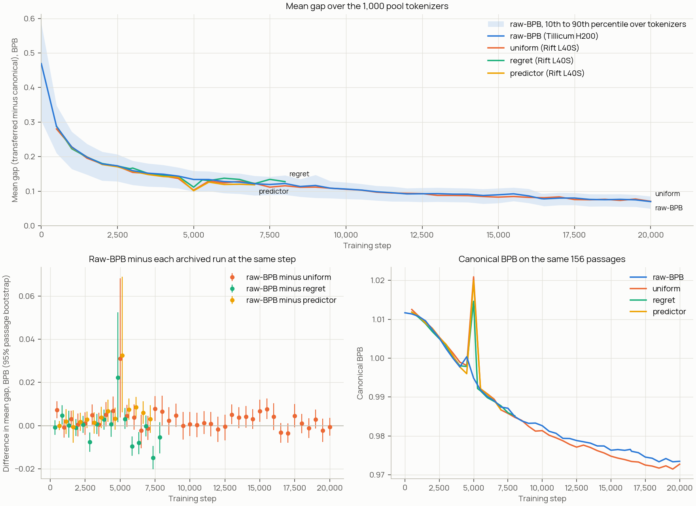

# Held-out full-pool eval of the raw-BPB run

Qingyun's held-out full-pool eval (**heldout-pool-4992**, commit 948787e, reports/heldout-pool-sweep on zett-modal-20k) on **every save of the raw-BPB run**: steps 0 to 20,000 every 500 plus 16,409, so **42 checkpoints, each scored on all 1,000 pool tokenizers**, on Tillicum H200s on 2026-11-24. Every tokenizer is scored on the same 156 frozen passages from nine domains, 32 canonical continuation tokens each (4,992 tokens and 14,429 bytes), with its own native prefix, the hypernetwork's dropout off and one generated embedding table per tokenizer. A tokenizer's **gap** is its transferred BPB minus the checkpoint's canonical BPB, averaged over the nine domains. Only the checkpoint list differs from his frozen plan (his `d1269e6fee0c…`, this run's `8d982055d80d…`).

## Result

The mean gap over the 1,000 tokenizers falls from **+0.4692 BPB** at step 0 to **+0.0697 BPB** at step 20,000. No tokenizer matches canonical at any save: the smallest gap at step 20,000 is +0.0350 (#144) and the largest +0.1000 (#910). Canonical BPB on the same passages falls from 1.0117 to 0.9735, so the gap shrinks while the canonical baseline it is measured against also improves.

| Step | Canonical BPB | Mean gap | 10th percentile | 90th percentile | Largest gap |
| ---: | ---: | ---: | ---: | ---: | ---: |
| 0 | 1.0117 | +0.4692 | +0.3038 | +0.5854 | +0.6226 (#597) |
| 500 | 1.0114 | +0.2873 | +0.2099 | +0.3479 | +0.3627 (#943) |
| 1,000 | 1.0107 | +0.2275 | +0.1641 | +0.2721 | +0.2890 (#103) |
| 2,000 | 1.0073 | +0.1789 | +0.1303 | +0.2141 | +0.2297 (#771) |
| 5,000 | 0.9949 | +0.1338 | +0.0987 | +0.1586 | +0.1797 (#941) |
| 10,000 | 0.9826 | +0.1061 | +0.0774 | +0.1255 | +0.1438 (#366) |
| 15,000 | 0.9763 | +0.0895 | +0.0655 | +0.1084 | +0.1302 (#910) |
| 16,409 | 0.9765 | +0.0782 | +0.0585 | +0.0935 | +0.1146 (#910) |
| 20,000 | 0.9735 | +0.0697 | +0.0495 | +0.0849 | +0.1000 (#910) |

Every save is in [checkpoint-summary.csv](checkpoint-summary.csv).

[PDF](rawbpb_heldout_pool.pdf)

## Against Qingyun's runs on the same eval

His public archive (qingy2024/anytok-rift-eval-resume at revision 38176d7d654b…) holds complete scores of three runs under the same frozen plan: **uniform** (40 saves, 500 to 20,000), **regret** (18 saves, 500 to 8,000) and **predictor** (14 saves, 500 to 7,000). They were scored on Rift L40S GPUs and this run on H200s; his protocol notes that another GPU type can shift BPB slightly.

| Step | Raw-BPB | Uniform | Regret | Predictor | Raw-BPB minus uniform [95% interval] |
| ---: | ---: | ---: | ---: | ---: | ---: |
| 500 | +0.2873 | +0.2801 | +0.2881 | +0.2873 | +0.0072 [+0.0034, +0.0113] |
| 1,000 | +0.2275 | +0.2283 | +0.2228 | +0.2256 | -0.0008 [-0.0056, +0.0031] |
| 2,000 | +0.1789 | +0.1785 | +0.1799 | +0.1771 | +0.0004 [-0.0049, +0.0056] |
| 3,000 | +0.1592 | +0.1543 | +0.1668 | +0.1579 | +0.0049 [+0.0002, +0.0098] |
| 4,000 | +0.1491 | +0.1440 | +0.1463 | +0.1423 | +0.0051 [-0.0005, +0.0109] |
| 5,000 | +0.1338 | +0.1028 | +0.1115 | +0.1013 | +0.0310 [+0.0039, +0.0681] |
| 6,000 | +0.1278 | +0.1239 | +0.1374 | +0.1193 | +0.0039 [-0.0019, +0.0098] |
| 7,000 | +0.1213 | +0.1226 | +0.1216 | +0.1183 | -0.0013 [-0.0067, +0.0045] |
| 8,000 | +0.1221 | +0.1156 | +0.1275 |  | +0.0066 [-0.0003, +0.0139] |
| 10,000 | +0.1061 | +0.1054 |  |  | +0.0007 [-0.0048, +0.0063] |
| 12,000 | +0.0920 | +0.0937 |  |  | -0.0017 [-0.0076, +0.0041] |
| 14,000 | +0.0911 | +0.0870 |  |  | +0.0041 [-0.0011, +0.0091] |
| 16,000 | +0.0861 | +0.0820 |  |  | +0.0042 [-0.0021, +0.0103] |
| 18,000 | +0.0760 | +0.0750 |  |  | +0.0010 [-0.0035, +0.0055] |
| 20,000 | +0.0697 | +0.0704 |  |  | -0.0007 [-0.0046, +0.0036] |

Over the 40 matching saves, raw-BPB minus uniform runs from -0.0035 (step 17,000) to +0.0310 (step 5,000). The 95% passage bootstrap interval lies above zero at 8 steps and below zero at 0. At step 20,000 the difference is -0.0007 [-0.0046, +0.0036]. Per-tokenizer gaps at step 20,000 rank the pool similarly in both runs (Spearman 0.822); their hardest 100 share 74 tokenizers. Every comparison is in [comparison.csv](comparison.csv).

At step 5,000 all three archived runs have canonical BPB between 1.0146 and 1.0209, above their own steps 4,000 and 6,000 (for example uniform 0.9990 and 0.9908); this run has 0.9949. Their lower mean gaps at that step come with that higher canonical BPB.

## Where the gap remains at step 20,000

| Algorithm / pretokenizer | Tokenizers | Share of the run's updates | Raw-BPB mean gap | Uniform mean gap | Raw-BPB minus uniform |
| --- | ---: | ---: | ---: | ---: | ---: |
| wordpiece / line256 | 120 | 10.5% | +0.0790 | +0.0857 | -0.0067 |
| wordpiece / no-regex | 106 | 51.6% | +0.0789 | +0.0859 | -0.0070 |
| unigram / regex | 135 | 0.3% | +0.0756 | +0.0574 | +0.0182 |
| unigram / no-regex | 115 | 22.7% | +0.0756 | +0.0804 | -0.0048 |
| bpe / no-regex | 105 | 11.0% | +0.0723 | +0.0786 | -0.0063 |
| unigram / line256 | 90 | 1.6% | +0.0716 | +0.0734 | -0.0018 |
| bpe / line256 | 112 | 2.1% | +0.0715 | +0.0785 | -0.0070 |
| wordpiece / regex | 102 | 0.2% | +0.0538 | +0.0508 | +0.0030 |
| bpe / regex | 115 | 0.2% | +0.0474 | +0.0451 | +0.0022 |

Raw-BPB is below uniform in 6 groups and above it in 3 (unigram / regex, wordpiece / regex, bpe / regex), most for unigram / regex (+0.0182). The 6 lower groups are 64.8% of the pool and drew 99.3% of the run's 20,000 updates; the 3 higher ones are 35.2% of the pool and drew 0.7%. Update shares come from the run's pick counts in reports/rawbpb-pool-ranking-20000/policy.json, which indexes the same pool.

Pool-mean gap by domain (byte-weighted within the domain):

| Domain | Passages | Raw-BPB step 0 | Raw-BPB step 10,000 | Raw-BPB step 20,000 | Uniform step 20,000 |
| --- | ---: | ---: | ---: | ---: | ---: |
| code | 17 | +0.4079 | +0.0995 | +0.0614 | +0.0731 |
| legal-en | 18 | +0.4214 | +0.0709 | +0.0500 | +0.0523 |
| math-en | 17 | +0.3205 | +0.0770 | +0.0617 | +0.0678 |
| medical-en | 17 | +0.5230 | +0.1658 | +0.1020 | +0.0990 |
| web-ar | 18 | +0.5019 | +0.1719 | +0.1138 | +0.1124 |
| web-en | 17 | +0.2565 | +0.0361 | +0.0242 | +0.0225 |
| web-hi | 17 | +0.3613 | +0.0510 | +0.0276 | +0.0341 |
| web-ja | 18 | +0.6780 | +0.1266 | +0.0843 | +0.0740 |
| web-zh | 17 | +0.7519 | +0.1562 | +0.1027 | +0.0987 |

The ten tokenizers with the largest gap at step 20,000, with their place in the uniform run at step 20,000:

| Rank | Tokenizer | Algorithm / pretokenizer | Vocab | Gap | Uniform rank | Uniform gap |
| ---: | ---: | --- | ---: | ---: | ---: | ---: |
| 1 | #910 | wordpiece / no-regex | 112,000 | +0.1000 | 1 | +0.1126 |
| 2 | #366 | wordpiece / line256 | 119,000 | +0.1000 | 2 | +0.1121 |
| 3 | #635 | bpe / no-regex | 120,000 | +0.0989 | 7 | +0.1063 |
| 4 | #943 | wordpiece / line256 | 98,000 | +0.0964 | 17 | +0.1032 |
| 5 | #3 | bpe / no-regex | 124,000 | +0.0963 | 15 | +0.1033 |
| 6 | #856 | bpe / line256 | 119,000 | +0.0962 | 5 | +0.1078 |
| 7 | #106 | wordpiece / line256 | 115,000 | +0.0961 | 3 | +0.1101 |
| 8 | #490 | wordpiece / line256 | 81,000 | +0.0955 | 6 | +0.1074 |
| 9 | #215 | wordpiece / no-regex | 75,000 | +0.0955 | 10 | +0.1047 |
| 10 | #114 | wordpiece / no-regex | 89,000 | +0.0947 | 4 | +0.1087 |

Ranks: 1 = largest gap of the 1,000. Every tokenizer of every save is in [rankings.csv.gz](rankings.csv.gz).

## How the ranking moves during training

Spearman correlation of the per-tokenizer gaps between consecutive saves is 0.269 from step 0 to 500, then at least 0.829 between consecutive saves from step 1,000 on (median 0.972). Step 10,000 against step 20,000: 0.871; step 0 against step 20,000: 0.595.

## Checks

- Every one of the 42,000 per-tokenizer score files was read on Tillicum: each carries this run's plan hash, its checkpoint, its index and its pool tokenizer's SHA-256, 156 finite non-negative passage losses, and a BPB and gap that recompute from those losses. Each checkpoint's ranking.csv lists the 1,000 tokenizers once in his order and matches those files, and each complete.json is his receipt (1,000 tokenizers, 156 passages, 4,992 tokens, 14,429 bytes).
- The scoring panel on Tillicum is byte-identical to the one in his archive, and the per-passage pool means used here reproduce every checkpoint's mean gap and canonical BPB.
- Slurm array 518632: 42 tasks, all COMPLETED with exit code 0, 19 to 22 minutes each, one H200 per task. The logs hold only model-loading progress bars and one Triton message per task (Python.h missing when Triton builds its driver helper); plans/rawbpb-heldout-pool.md explains why that message cannot change a score.
- Cost: 14.04 GPU-hours, $12.64 for the array, plus $0.24 for the 5 setup jobs (smoke test, panel audit, preflight and two diagnostics). hyakusage for the stf account moved from $70.55 to $83.19 of $250 over the array. Every job is in [jobs.csv](jobs.csv).

## Limits

- One fixed panel. The intervals resample its passages within each domain; they do not cover run-to-run training variation (each curriculum here is a single run) or the GPU type.
- The archived runs were scored on L40S GPUs and this run on H200s. The size of that shift was not measured, so differences of a few ten-thousandths of a BPB between runs should not be read as real.
- Each gap is measured against its own checkpoint's canonical BPB, which changes during training, so a smaller gap can come from better transfer or from a worse canonical baseline.

## Files

- [checkpoint-summary.csv](checkpoint-summary.csv): one row per checkpoint of all four runs.
- [comparison.csv](comparison.csv): raw-BPB against each archived run at every matching step, with the bootstrap interval, Spearman correlation and shared hardest 100.
- [domains.csv](domains.csv) and [groups.csv](groups.csv): the pool-mean gap by domain for every checkpoint, and by algorithm and pretokenizer at step 20,000.
- [rankings.csv.gz](rankings.csv.gz): the 42 ranking.csv files of this run, concatenated.
- [passage-means.json.gz](passage-means.json.gz): the panel's passage domains and bytes, and each checkpoint's canonical and pool-mean transferred losses per passage, for all four runs.
- [analysis.json](analysis.json) holds every number above; [manifest.json](manifest.json) the inputs' and files' hashes.
- The per-tokenizer score files (losses for every passage of every pair) are on Hugging Face, one archive per checkpoint: [raw-bpb-rl-20k/diagnostics/heldout-pool-4992](https://huggingface.co/Dekiofsa/RLtokenizers/tree/fb8f2a00409a98e41ea02337784eda5c2c956e5f/raw-bpb-rl-20k/diagnostics/heldout-pool-4992) in Dekiofsa/RLtokenizers, revision fb8f2a00. Each raw-bpb-NNNNNN.tar.gz unpacks to the scorer's folder raw-bpb-NNNNNN/; [manifest.json](manifest.json) lists their SHA-256.

Made by scripts/report_rawbpb_heldout_pool.py from the scores copied off Tillicum and his archive.
