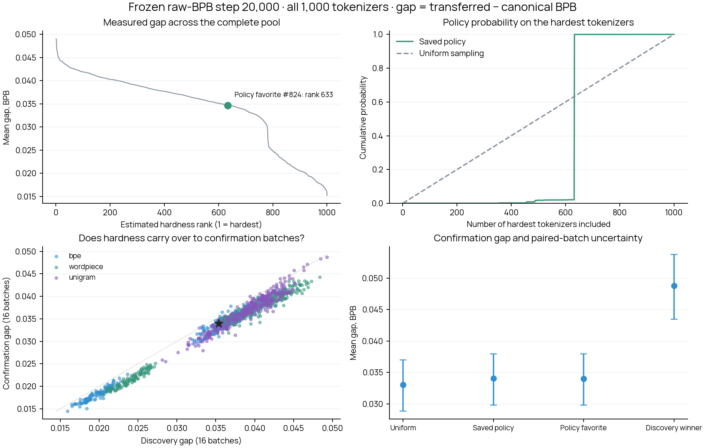

# Frozen raw-BPB policy versus complete pool hardness

Frozen checkpoint **20,000** of the raw-BPB run, all **1,000** native pool tokenizers, **32 × 128** training-style examples per tokenizer, on a fresh panel, the next 32 training batches the run would have drawn after step 20,000 (see What was scored); panel items from wiki-ja and wiki-zh repeat text the run trained on in an earlier pass. The primary ranking is by **gap** (transferred minus canonical BPB), the metric of the regret run's step-6,500 ranking (reports/regret-pool-ranking-6500 on zett-modal-20k), which calls it regret, so ranks compare with that chart; absolute values do not, because the run, checkpoint, reward and panel all differ. **Raw BPB** (transferred BPB), this run's training reward, is reported alongside.

## Gap, as in the step-6,500 ranking

The saved policy favorite is **#824**, with **97.89%** probability and estimated gap rank **633/1,000**. Its mean gap is **+0.034687 BPB**.

Uniform expected gap: **+0.034168 BPB**. Policy expected gap: **+0.034730 BPB**. Estimated maximum: **+0.049025 BPB**, tokenizer **#116**. Estimated oracle-minus-policy headroom: **0.014295 BPB**.

Policy minus uniform: **+0.000562 BPB** (discovery half +0.000131, confirmation half +0.000993; positive in 19 of 32 batches), 32-batch bootstrap 95% interval **[-0.000221, +0.001344]**. The policy is not distinguishable from uniform sampling on these batches.

Policy probability on the estimated hardest 1 / 10 / 50 / 100: **2.47e-10 / 4.33e-08 / 1.35e-07 / 3.11e-07**.

Discovery winner **#116** minus policy favorite on the 16 held-out confirmation batches: **+0.014733 BPB**, paired-batch bootstrap 95% interval **[+0.012372, +0.017278]**. Discovery winner has higher gap on confirmation batches.

## Raw BPB, this run's reward

Ranked by mean raw BPB, the policy favorite **#824** is **653/1,000** at **0.906668 BPB**. The raw-BPB peak is **#127** (unigram / regex / 99,000): raw BPB **0.929943**, gap **+0.048432** (gap rank 2). The gap peak **#116** (unigram / regex / 120,000) has raw BPB **0.929493** (raw-BPB rank 2). Over all 1,000 tokenizers the gap and raw-BPB rankings have Spearman **0.970**, but they agree less on which are hardest: their hardest 10 / 50 / 100 share **6 / 21 / 55** tokenizers.

Uniform expected raw BPB: **0.906893**. Policy expected raw BPB: **0.906710**. Estimated maximum: **0.929943**, tokenizer **#127**. Estimated oracle-minus-policy headroom: **0.023233 BPB**.

Policy minus uniform: **-0.000183 BPB** (discovery half -0.000770, confirmation half +0.000404; positive in 13 of 32 batches), 32-batch bootstrap 95% interval **[-0.001028, +0.000655]**. The policy is not distinguishable from uniform sampling on these batches.

Policy probability on the estimated hardest 1 / 10 / 50 / 100 by raw BPB: **2.37e-10 / 2.38e-09 / 6.34e-08 / 2.98e-07**.

Raw-BPB discovery winner **#127** minus policy favorite on the 16 held-out confirmation batches: **+0.023774 BPB**, paired-batch bootstrap 95% interval **[+0.019638, +0.027891]**. Discovery winner has higher raw BPB on confirmation batches.

Rank stability between the discovery and confirmation halves (Spearman): gap **0.978**, raw BPB **0.980**. The halves' hardest 10 / 50 / 100 share **4 / 33 / 74** tokenizers by gap and **9 / 39 / 82** by raw BPB, so close ranks among the hardest are not decisive.

## Against the step-6,500 ranking

Per-tokenizer mean gap here against the regret run's step-6,500 ranking (reports/regret-pool-ranking-6500 on zett-modal-20k): Spearman **0.824**, Pearson **0.915** (mean raw BPB: Spearman 0.832, Pearson 0.918). Over the 782 tokenizers outside the bottom group described next, the gap Spearman is **0.633** (Pearson 0.598). The two hardest-100 sets by gap share **19** tokenizers. That chart's bottom group, its ranks 783–1,000 (218 tokenizers: 115 regex BPE, 102 regex WordPiece and 1 regex Unigram, #169), ranks **782–1,000** here (median 891.5); **217 of 218** are among the last 218 here. The 217 regex BPE and regex WordPiece tokenizers fill ranks 784–1,000 in both rankings; #169 (regex Unigram) is rank 782 here and 783 at step 6,500. Its mean gap is **+0.020958** here against **+0.037851** for the other 782 (step 6,500: +0.042572 against +0.072726). The two rankings differ in model and panel together, so a difference cannot be assigned to either.

## Selected tokenizers

The rows are the run's 9 most-picked tokenizers over its 20,000 updates. Picks counts how often the run sampled each tokenizer (policy.json counts). The step-20,000 probabilities are a snapshot: the most-picked tokenizer over the run is #771 (3,158 picks), while the step-20,000 favorite #824 was picked 1,747 times.

| Tokenizer | Algorithm / pretokenizer | Vocab | Gap rank | Mean gap | Raw-BPB rank | Mean raw BPB | Step-6,500 rank | Policy probability (step 20,000) | Picks (of 20,000) |
| ---: | --- | ---: | ---: | ---: | ---: | ---: | ---: | ---: | ---: |
| #824 | bpe / no-regex | 127,000 | 633 | +0.034687 | 653 | 0.906668 | 582 | 0.97893 | 1,747 |
| #170 | unigram / no-regex | 125,000 | 70 | +0.042483 | 129 | 0.914441 | 4 | 7.2577e-10 | 3,044 |
| #771 | wordpiece / no-regex | 127,000 | 31 | +0.043630 | 80 | 0.915588 | 323 | 1.0289e-08 | 3,158 |
| #103 | wordpiece / no-regex | 127,000 | 23 | +0.044140 | 69 | 0.916098 | 247 | 8.5027e-09 | 2,237 |
| #873 | wordpiece / no-regex | 125,000 | 9 | +0.044957 | 47 | 0.916916 | 243 | 3.5568e-08 | 1,186 |
| #281 | wordpiece / no-regex | 124,000 | 46 | +0.043071 | 99 | 0.915029 | 264 | 1.9331e-08 | 814 |
| #314 | wordpiece / line256 | 125,000 | 22 | +0.044189 | 68 | 0.916148 | 158 | 2.3267e-09 | 797 |
| #792 | unigram / no-regex | 113,000 | 186 | +0.040471 | 248 | 0.912448 | 50 | 9.9965e-10 | 338 |
| #941 | unigram / no-regex | 125,000 | 25 | +0.043979 | 71 | 0.915938 | 1 | 1.2205e-09 | 295 |

Ranks: 1 = hardest of 1,000.

## What was scored

**Fresh panel.** The next 32 training batches of 128 windows (4,096 initial examples, all 23 corpus buckets) that the run would have drawn after its step-20,000 full restart, and the ordered 128-window replacement banks per bucket and batch, drawn from that checkpoint's saved corpus stream and Python RNG with no replay. It is not the panel of the step-6,500 ranking.

**Cross-check:** the step-18,000 full restart was restored and the data stream of the 2,000 logged updates 18,001–20,000 was replayed (corpus draws, Python RNG and each update's paired examples for its logged tokenizer; no model updates); 2,000 of 2,000 logged paired-batch hashes and rejected-example counts matched (7 rejected examples in total), and the replayed stream drew an identical panel.

**Not all unseen.** wiki-ja and wiki-zh were past the first pass over their training quota when the panel was drawn (passes completed at step 20,000 → after the panel items: wiki-ja 1 → 1, wiki-zh 1 → 1). Windows drawn in a later pass repeat text the run trained on in an earlier pass; these buckets hold 91 of the 4,096 panel items.

All actions used the same primary text draws and ordered replacement banks. Original rejected-example behavior and limits were preserved.

Each action used its native prefix, a variable canonical continuation, matched canonical control, batch 128, microbatch 32 and the original 128-total-position cap. Canonical targets/bytes match each transferred pair; cuts can differ between actions exactly as in training. Canonical controls were recomputed for each action. Hypernetwork dropout stayed active with fixed independent per-batch seeds; a new embedding table was generated for every batch. No model or policy updates occurred.

Gap and raw BPB are byte-weighted within each update, then averaged equally across updates. Raw BPB matches this run's policy reward; gap is the regret of the step-6,500 ranking, kept as the primary ranking. Lexical loss is excluded. No fixed-32-token or deterministic-dropout substitute was used.

## Interpretation limits

These are finite estimates of stochastic training-distribution rewards, not exact population ranks or a held-out generalization evaluation. The all-batch maximum is selected from 1,000 noisy estimates. The discovery winner is therefore also compared on held-out confirmation batches. Bootstrap intervals describe variation across these fixed training-reward batches; sequential corpus windows can be correlated. Close ranks should not be treated as decisive.

This policy was trained on raw BPB, not on gap; the gap ranking is kept for comparison with the step-6,500 chart. That chart ranks another run's model at another checkpoint, so its ranks describe that model.

[PDF](rawbpb_pool_ranking_20000.pdf) · [Every tokenizer](tokenizer-ranking.csv) · [Analysis](analysis.json)

| Rank | Tokenizer | Algorithm / pretokenizer | Vocab | Policy probability | Mean gap |
| ---: | ---: | --- | ---: | ---: | ---: |
| 1 | #116 | unigram / regex | 120,000 | 2.4669e-10 | +0.049025 |
| 2 | #127 | unigram / regex | 99,000 | 2.3664e-10 | +0.048432 |
| 3 | #822 | unigram / regex | 123,000 | 2.5343e-10 | +0.046944 |
| 4 | #687 | unigram / regex | 108,000 | 2.4148e-10 | +0.046397 |
| 5 | #443 | wordpiece / line256 | 126,000 | 3.5942e-09 | +0.046327 |
| 6 | #870 | unigram / regex | 104,000 | 2.4475e-10 | +0.046039 |
| 7 | #95 | unigram / regex | 78,000 | 2.317e-10 | +0.045430 |
| 8 | #397 | wordpiece / line256 | 123,000 | 1.0869e-09 | +0.045306 |
| 9 | #873 | wordpiece / no-regex | 125,000 | 3.5568e-08 | +0.044957 |
| 10 | #784 | wordpiece / line256 | 120,000 | 1.5538e-09 | +0.044944 |
