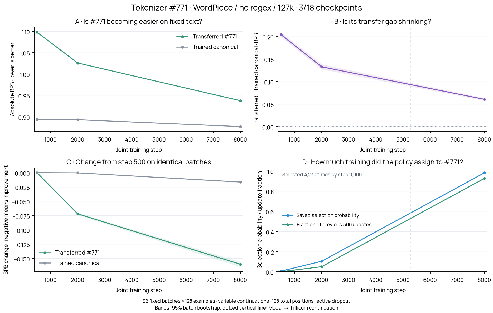

# Does the model improve on the tokenizer the policy keeps selecting?

**In progress: 3 of 18 saved checkpoints scored.** Tokenizer **#771** is the original **WordPiece / no regex / 127k** pool tokenizer. No model or policy updates occur in this evaluation.

On these identical batches, transferred BPB changes from **1.097718** at step **500** to **0.937476** at **8,000**. Its canonical gap changes from **+0.204299** to **+0.060485 BPB**.

[PDF](regret_favorite_trajectory.pdf) · [Every checkpoint](learning-curve.csv) · [Analysis and uncertainty](analysis.json)

## What the evaluation measures

Every checkpoint sees the same complete 32 × 128 training-style examples from the frozen step-6,500 ranking panel, covering all 23 original training corpus buckets. Native #771 prefixes and canonical continuations use the unchanged paired cut helper and fit BOS + prefix + variable continuation within 128 positions. Continuations, token counts, byte counts, contexts and pairing hashes are verified identical across checkpoints. Each saved LM also scores its matching canonical control.

The LM and hypernetwork stay frozen. Hypernetwork dropout remains active, with the same independent CUDA seed per batch across checkpoints and a fresh full-vocabulary embedding table each batch. Batch 128, microbatch 32, BF16 autocast and the validated GPU-only memory implementation match the training-reward diagnostic. BPB is byte-weighted within each update and then averaged equally across the 32 updates.

Panel A shows absolute loss, B shows the transfer gap relative to each trained canonical LM, C shows paired changes from the earliest scored checkpoint, and D shows policy focus. The shaded bands resample the same 32 batches 10,000 times. Negative changes in panel C mean improvement.

## Checkpoint lineage and limits

The full sweep includes all saved 500-step checkpoints through 8,000, along with the 2,912 and 5,288 handoff checkpoints. The earliest available saved checkpoint is 500; no step-zero result is reconstructed. The earlier Modal continuation beyond 5,288 was discarded when training moved to Tillicum. Its obsolete 5,500 checkpoint is excluded; 5,500 onward uses the resumed committed Tillicum trajectory. The dotted vertical line marks that continuation.

All trajectory points run on the same local RTX PRO 6000 with torch 2.15.0. Cross-device bitwise equality with the separate H200 ranking is not claimed. Corpus/tokenizer cloud originals and checkpoints remain intact. Only a temporary weight-only diagnostic copy is downloaded for each checkpoint, without optimizer state.

This checks progress on a fixed training-distribution panel. It is not a held-out generalization test: the panel is drawn after step 6,500 and its corpus region can be seen in later training. Bootstrap intervals describe variation across these 32 fixed batches; sequential corpus windows can be correlated. Policy concentration and improvement on #771 alone do not establish improvement on other tokenizers. The curve is observational and does not isolate the causal effect of adversarial selection.

A lower absolute transferred BPB means the model scores this tokenizer better. A smaller canonical gap means transfer is also improving relative to that checkpoint’s canonical LM. The gap depends on the LM and hypernetwork together; it does not isolate the hypernetwork alone.

| Step | Transferred BPB | Canonical BPB | Gap BPB | Policy probability | Selections so far |
| ---: | ---: | ---: | ---: | ---: | ---: |
| 500 | 1.097718 | 0.893419 | +0.204299 | 0.5662% | 0 |
| 2,000 | 1.025665 | 0.893025 | +0.132639 | 10.3905% | 40 |
| 8,000 | 0.937476 | 0.876991 | +0.060485 | 98.1379% | 4,270 |
