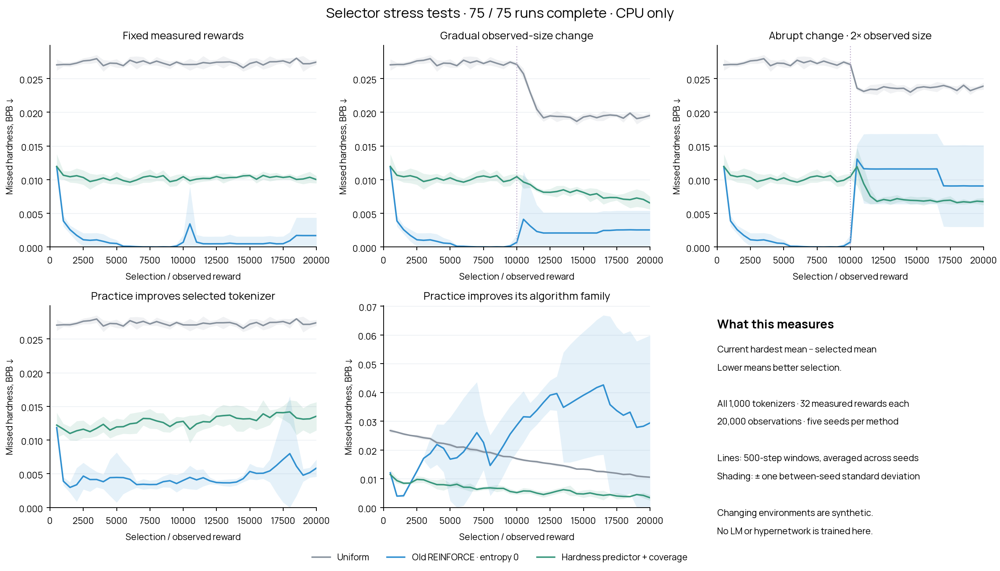
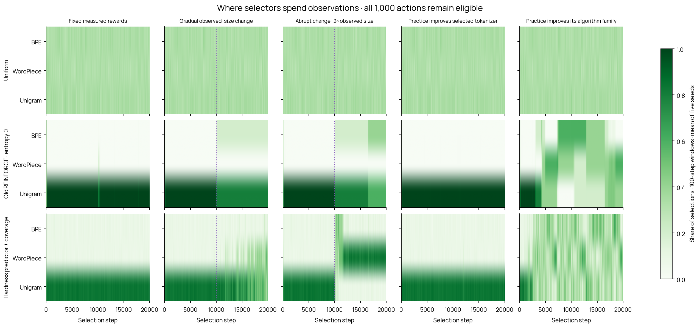
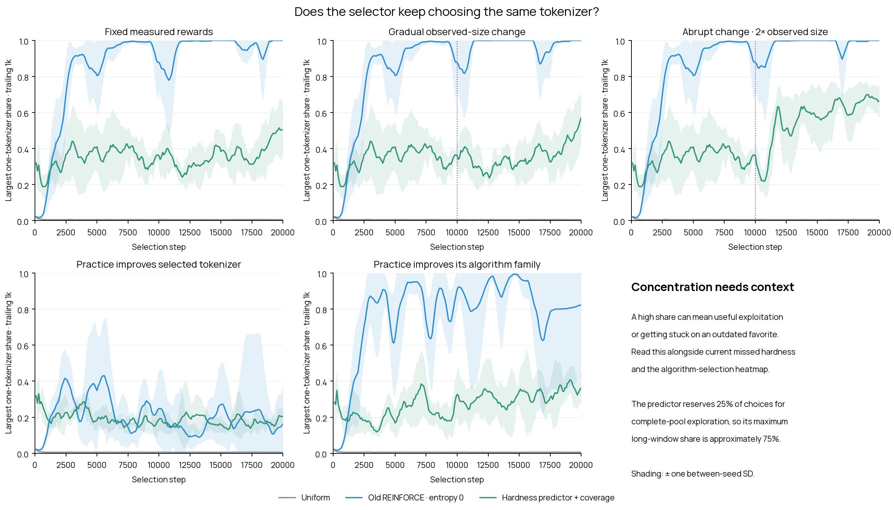

# Selector simulations: can the selector track changing weaknesses?

**75 / 75 runs complete.** Five environments × three selectors × five seeds, each with 20,000 observations. All work is local CPU; the real LM and hypernetwork remain unchanged.

## What is measured and what is simulated

The fixed environment resamples the complete 1,000 × 32 reward table measured at model checkpoint 6,500. A batch index is drawn uniformly with replacement at every step; all methods within a seed see the same batch-index sequence. Each reward is the selected tokenizer’s paired BPB gap on that batch. These are finite empirical reward distributions, not fresh language-model evaluations or estimates of all future text.

The changing environments retain each tokenizer’s centered measured noise and change its mean. Calibration uses tokenizer #771: gap 0.072972 at 6,500 to 0.060485 at 8,000, a drop of 0.012487 over 1,500 updates and 1381 observed selections. This is an observational curve with joint-model changes and cross-tokenizer effects. It does **not** identify a causal learning rate. The following are explicit stress-test assumptions.

| Environment | Rule |
| --- | --- |
| Fixed | No mean changes. All 32 measured rewards remain available per action. |
| Gradual | Starting at selection 10,000, reduce every Unigram mean by the observed gap drop, linearly over 1,500 steps; hold it there. |
| Abrupt | At 10,000, immediately reduce every Unigram mean by twice that drop. This is deliberately stronger than the observed change. |
| Practice: tokenizer | Every selection exponentially reduces that tokenizer’s mean; the observed gap ratio is reproduced after the observed number of selections. |
| Practice: family | The same update reduces the means of all tokenizers in the selected algorithm family. This assumes complete within-family transfer. |

## Selectors and fairness

Every cell starts with fresh original weights and optimizer state. The new predictor is imported unchanged: the shared 18→64→64→1 settings MLP, float64, Adam 0.001, one MSE update on the current observation, and one shuffled full-pool exploration choice every four steps. It receives no reference labels beyond its selected action’s reward. The old baseline imports the exact original SettingsTokenizerBandit: sampled softmax, REINFORCE, EMA baseline 0.99, Adam 0.001 and entropy coefficient **0**. Uniform selects independently from all 1,000 actions. These compare the complete selector designs; they do not isolate regression from forced exploration. No method gets a warm start from the frozen pilot.

A seed pairs the environment’s batch-index stream across methods and is also used for learner initialization. The simulator can inspect all current means for evaluation, but the selector receives exactly one selected-action reward per step. No counterfactual scores enter learner updates. Source hashes and exact parameters are in plan.json.

## How to read the results

**Missed hardness = largest current mean reward − selected tokenizer’s current mean reward.** Lower is better. This is selection shortfall, not the BPB-gap reward itself. It includes the cost of the predictor’s mandatory exploration. The comparator knows current means, not future noisy rewards or long-run consequences. Selecting an easy tokenizer can improve the model too; this metric tests immediate hard-example mining, not optimal future learning.

In the practice environments, each selector creates its own evolving environment. Absolute rewards and maximum rewards can therefore differ because a selector has already reduced weaknesses. Compare selection shortfall in each current world; do not interpret lower raw reward as worse selection. Shading is between-seed standard deviation, not a confidence interval.

The full traces retain all actions, observed rewards, true selected means, true current maxima, ranks and exploration flags. They permit checking concentration, switches and transient failures instead of judging the final average alone. Synthetic success would justify a joint-training test; it would not establish language-model generalization.



[PDF](selector_simulations.pdf) · [Summary](summary.csv) · [Per-seed learning curves](learning-curves.csv) · [Aggregated curves](aggregate-curves.csv)





[Before/after window diagnostics](window-diagnostics.csv) separate the predictor’s exploitation choices from its mandatory exploration. Per-step numeric traces for every cell are in `traces/` (NumPy NPZ).

| Environment | Selector | Complete seeds | Final 2k missed hardness, BPB ↓ |
| --- | --- | ---: | ---: |
| Fixed measured rewards | Uniform | 5 | 0.027476 ± 0.000330 |
| Fixed measured rewards | Old REINFORCE · entropy 0 | 5 | 0.001710 ± 0.002661 |
| Fixed measured rewards | Hardness predictor + coverage | 5 | 0.010130 ± 0.000556 |
| Gradual observed-size change | Uniform | 5 | 0.019429 ± 0.000238 |
| Gradual observed-size change | Old REINFORCE · entropy 0 | 5 | 0.002550 ± 0.002864 |
| Gradual observed-size change | Hardness predictor + coverage | 5 | 0.006982 ± 0.001120 |
| Abrupt change · 2× observed size | Uniform | 5 | 0.023673 ± 0.000243 |
| Abrupt change · 2× observed size | Old REINFORCE · entropy 0 | 5 | 0.009071 ± 0.006071 |
| Abrupt change · 2× observed size | Hardness predictor + coverage | 5 | 0.006730 ± 0.000162 |
| Practice improves selected tokenizer | Uniform | 5 | 0.027422 ± 0.000354 |
| Practice improves selected tokenizer | Old REINFORCE · entropy 0 | 5 | 0.005476 ± 0.001585 |
| Practice improves selected tokenizer | Hardness predictor + coverage | 5 | 0.013264 ± 0.001812 |
| Practice improves its algorithm family | Uniform | 5 | 0.010933 ± 0.000170 |
| Practice improves its algorithm family | Old REINFORCE · entropy 0 | 5 | 0.029660 ± 0.028793 |
| Practice improves its algorithm family | Hardness predictor + coverage | 5 | 0.003968 ± 0.000431 |

## What happened

The predictor is not uniformly better than REINFORCE. REINFORCE has smaller average final selection shortfall in the fixed, gradual-change and tokenizer-only-practice environments. The predictor has smaller average shortfall in the abrupt-change and family-practice environments. These comparisons include all exploration choices and use the final 2,000 observations, averaged across five seeds.

The family-practice result is especially variable for REINFORCE: read the individual seeds and concentration plots, not only the mean. The predictor repeatedly switches among families, whereas some REINFORCE runs spend observations on families they have already made easier. Under tokenizer-only improvement, the shared predictor has to distinguish many similar settings with different selection histories; this is a weakness of its current settings-only input. These are interpretations of controlled simulations, not established explanations of the real training run.

Continued exploration has a visible price when the world is stable: the predictor deliberately spends 25% of observations on shuffled coverage. The exploitation-only rows in window-diagnostics.csv help separate this price from prediction quality. This comparison does not isolate the benefit of regression from the benefit of exploration.

The useful next real-world measurement is how broadly improvement transfers to neighboring tokenizers while training. That determines which simulated response is relevant. These results support testing adaptation during joint training; they do not prove the new selector will outperform REINFORCE on real LM training or held-out generalization.

## Verification and reproduction

The audit independently reconstructs every observed reward and current maximum for all 1,500,000 steps, checks pinned source and trace hashes, and verifies five exploration visits per tokenizer in every predictor run. See [completion-audit.json](completion-audit.json). Re-run with the existing project CPU environment:

```bash
CUDA_VISIBLE_DEVICES= OMP_NUM_THREADS=1 OPENBLAS_NUM_THREADS=1 .venv-memory/bin/python scripts/run_selector_simulations.py
.venv-memory/bin/python scripts/audit_selector_simulations.py
.venv-memory/bin/python scripts/report_selector_simulations.py
```

The controller preserves completed runs after verifying their trace hashes; interrupted runs repeat deterministically from their seed. It refuses changed pinned inputs or simulator code in the same run directory. The real LM weights are not needed.

