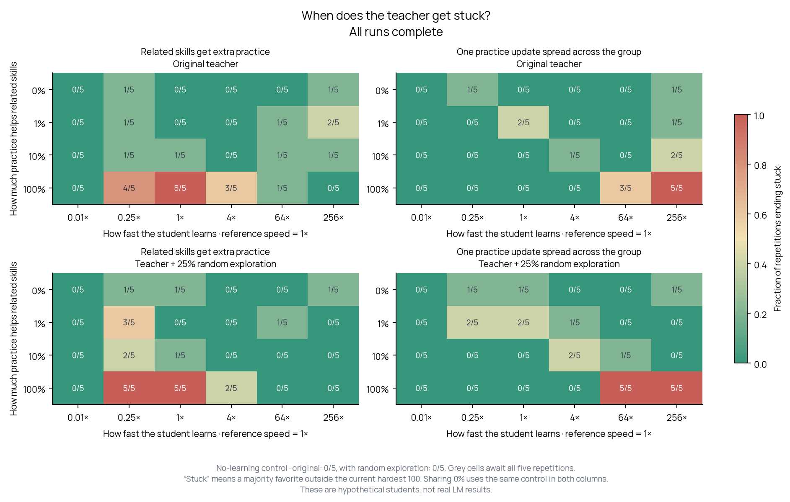

# How far does the stale-teacher failure generalize?

[Live progress and plots](http://100.84.104.59:1337/?run=student-generalization). Repository snapshots can lag the running study.

**37 / 1,380 runs complete.** This is a local CPU study; real training stays paused. Live plots are provisional until every planned observation passes the independent audit.

We test whether an adversarial teacher keeps choosing problems that used to be hard after a synthetic student improves. The first study used either no sharing or complete sharing across a tokenizer algorithm. This study fills in the gap between those extremes and varies student speed independently.

Practice can help related skills by 0%, 1%, 10% or 100% of its direct effect. Student speeds range from 100 times slower to 256 times faster than the earlier reference rule. We compare giving neighbours extra practice with spreading one fixed practice update across the group. The latter conserves practice weight, not the exact amount of loss reduction.

The follow-up checks remove or double observation noise, change learning plateaus and curve shapes, use smaller or randomly shuffled skill groups, share across all skills, and flatten or shuffle initial difficulty. Matched frozen controls accompany noise and initial-difficulty changes. Every condition is declared before results.

All 1,000 tokenizer settings and all 32 measured batch residuals remain present. Five new teacher-network seeds (48–52) are paired across conditions. The teacher sees only its selected reward. The original REINFORCE network is compared with its correctly differentiated 25% uniform mixture, uniform choices, and an evaluator-only reference that always chooses a currently hardest problem. That reference is not an optimal long-term teacher.

[Actual choice quality](student_generalization_choices.png) · [Learned choice quality before exploration](student_generalization_focus.png)

A repetition ends stuck when, for most of its final 2,000 choices, at least half the sampling probability is on a favorite outside the current hardest 100. This binary summary is accompanied by continuous choice-quality scores, so the conclusion need not depend on that particular cutoff. Each method creates its own student history; compare a choice with the alternatives available in that same world.

The summary also pairs each repetition with its frozen-student control using the same noise, starting difficulty and teacher seed. This distinguishes failures introduced by learning from failures that already occur without student change.

The uniform-mixture intervention changes actual sampling and differentiates its actual probability. Random observations can carry little policy-gradient credit when the learned probability is already tiny. More exploration is therefore not assumed to be a universal cure.

These are controlled hypothetical learning rules, not estimates that a real LM improves by this amount or transfers knowledge within these groups. The plots should identify hypotheses for real-world tests, including regions where our explanation fails.

## Data and reproduction

`python scripts/run_student_generalization.py` runs the frozen full plan. `python scripts/report_student_generalization.py --partial` refreshes the live views; without --partial it independently reconstructs every saved reward, student update and rank. Per-step traces and receipts remain under `modal_results/student_generalization/cells/`; full summary metadata are in this folder. No tokenizers, corpora or model checkpoints are downloaded.
