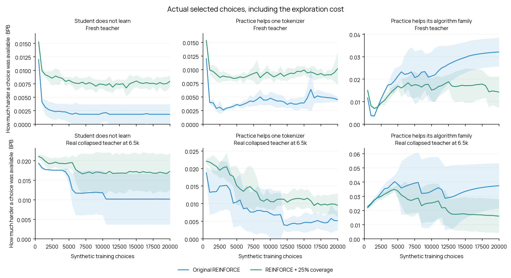

# Can an adversarial teacher keep up with a learning student?

This CPU-only experiment isolates exploration in the original REINFORCE teacher. The synthetic student begins with the measured difficulty of all 1,000 tokenizers at model step 6,500. It can stay unchanged, improve only on the selected tokenizer, or improve on every tokenizer using the selected algorithm. The learner sees only its selected tokenizer’s noisy reward.

Practice removes a learnable deficit and eventually reaches a floor. We set that floor to half the initial difficulty, and choose the learning rate once from the observed relative improvement of tokenizer #771. Both the floor and the extent of shared improvement are hypothetical assumptions, not fitted causal properties of the real model. The original 32 measured noise values per tokenizer are retained.

We compare original entropy-zero REINFORCE with the same network and optimizer sampling from 75% learned probability plus 25% uniform probability. The exploratory version differentiates the probability distribution it actually samples. There is no hardness predictor in this experiment.

Each condition starts either from the original uniform policy or from the actual collapsed policy at step 6,500. The latter is reconstructed from every recorded action and reward; every replayed action and advantage must match, along with final probabilities and counts. Five paired future sampling and noise streams branch from the same initial state. These repetitions do not represent five independently trained real models.

## Results

The table measures the final 2,000 choices. “Harder choice available” is the current maximum mean gap minus the selected tokenizer’s mean gap. Lower means the teacher chose closer to the hardest remaining alternative. It includes the immediate cost of uniform exploration. The learned-policy-only view is reported separately. Values are means ± sample standard deviations across five paired continuation streams, not confidence intervals.

| Synthetic student | Teacher start | Original REINFORCE | With 25% coverage |
| --- | --- | ---: | ---: |
| Student does not learn | fresh | 0.00183 ± 0.00187 | 0.00768 ± 0.00099 |
| Student does not learn | collapsed | 0.01020 ± 0.00651 | 0.01701 ± 0.00478 |
| Practice helps one tokenizer | fresh | 0.00471 ± 0.00057 | 0.00944 ± 0.00128 |
| Practice helps one tokenizer | collapsed | 0.00521 ± 0.00305 | 0.00975 ± 0.00290 |
| Practice helps its algorithm family | fresh | 0.03196 ± 0.00640 | 0.01449 ± 0.00669 |
| Practice helps its algorithm family | collapsed | 0.03718 ± 0.01612 | 0.01633 ± 0.01194 |

With a fresh teacher and no coverage, an outdated majority persists through most of the final window in 0/5 frozen-student continuations, 0/5 individual-learning continuations and 5/5 family-learning continuations. Starting from the real collapsed policy, it persists in 3/5 continuations even after the student is frozen.

Those comparisons separate two questions: whether the student’s learning rule can produce the failure from a fresh teacher, and whether a teacher with a real collapsed history recovers once the student stops changing. Neither result alone identifies the cause of the original real training collapse.

[Learned choices without exploration](synthetic_student_focus.png) · [Outdated majority favorites](synthetic_student_stale.png) · [Synthetic student progress](synthetic_student_learning.png)

A majority is labeled outdated only when its tokenizer has at least 50% actual selection probability and lies outside the current hardest 100. Concentration on a tokenizer that remains hard is not counted as failure.

Uniform mixing mechanically reduces the maximum sampling probability. A smaller outdated-majority fraction by itself does not prove that the learned ranking improved; read it alongside the learned-policy-only scores and favorite ranks.

Student histories diverge across selectors. Compare each choice with the alternatives available to that teacher at that moment. A lower observed reward can mean the student has already improved, rather than that the teacher selected badly. Synthetic student progress is not evidence of real LM generalization.

Hardest-task selection and useful teaching are separate objectives. A tokenizer can remain hard because it is near an irreducible floor. Selecting it can maximize immediate reward while doing little to improve the student. The mastery plot tracks the synthetic learnable deficits separately.

mechanism-observations.csv counts what happens while a teacher has an outdated majority favorite: how often it observes a genuinely harder alternative, whether that observation produces a positive policy advantage, and whether the update then increases that alternative’s probability. A nonpositive advantage can reflect batch noise or a stale reward baseline; this count alone does not distinguish them.

The exploration intervention is specifically an on-policy uniform mixture. Its gradient on a sampled action is weighted by `(1-epsilon) * pi(action) / q(action)`. An alternative can therefore be observed through the uniform component yet receive little gradient credit when its learned probability is tiny. The mechanism table records this factor. These results do not test a shuffled-coverage learner with another way of using exploration observations.

## Audit and reproduction

All 60 runs and all 1.2 million observations are retained. The audit reconstructs every reward, chosen/favorite rank and student update from the saved actions. Source and trace hashes are pinned. No world, seed or method is selected for favorable results. The original 75-run simulator remains separate and unchanged.

`python scripts/run_synthetic_student.py` runs the experiment and report. `python scripts/report_synthetic_student.py` independently repeats the trace audit and rebuilds the report. Every per-step trace is included in traces/, with receipt hashes in per-run-results.csv. Original working copies remain in `modal_results/synthetic_student/cells/*/trace.npz`. policy-history.jsonl.gz contains the original scalar training log needed to reconstruct the initial collapsed policy; decompress it to `modal_results/anytok_pool_regret_rl_20k/committed-train.log` when reproducing in a fresh checkout. Original full-pool reward inputs are in `reports/regret-pool-ranking-6500/`. There are no real LM updates or GPU allocations.
